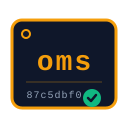

<div align="center">



# Oh-My-Skills

**The verified instruction files [Skill Forge](https://github.com/armelhbobdad/bmad-module-skill-forge) produces when you point it at real libraries. Nothing is made up — every line traces back to a commit SHA.**

[](LICENSE)
[](#the-four-skills-pinned)
[](#dont-trust-us-audit-us)
[](https://agentskills.io)
[](https://github.com/armelhbobdad/bmad-module-skill-forge)
[](https://discord.gg/gk8jAdXWmj)
[](https://github.com/armelhbobdad/oh-my-skills/stargazers)

**If these skills saved you from hallucinations, [grab me a coffee ☕](https://buymeacoffee.com/armelhbobdad) — it helps me keep forging.**

</div>

---

Your AI coding assistant doesn't read documentation. It pattern-matches against a snapshot of the internet from months ago, and then confidently writes code against functions that were deprecated two releases back. You find out after three stack traces and a trip to GitHub to read the source — which is where the assistant should have been looking all along.

This repository is the antidote. Not more curation. **Compilation.** Each skill is built from a specific upstream commit, every documented symbol cites its source file and line with a tag that says how it was read (`[AST:]` when an ast-grep rule matched the definition, `[SRC:]` when the source was read by eye), and every claim can be audited against the upstream in under 60 seconds. When we're wrong, the test report says we're wrong.

This repo is what [Skill Forge](https://github.com/armelhbobdad/bmad-module-skill-forge) produces. Four libraries today, all Deep-tier. **All four pass Skill Forge 10.0.0's test gate** on a strict test of the version that ships, run as Skill Forge designs it, with its subagents: cocoindex, Storybook and uitripled at **100%**, cognee at **99%**, its one point lost to skill-check's token budget for its `SKILL.md` body. cognee was blocked under 7.0.0 and 8.0.0 by two false positives in Skill Forge's own comparison, which checked one documented function against another function of the same name; 9.0.0 compares each form with the declaration its own citation names ([bmad-module-skill-forge#918](https://github.com/armelhbobdad/bmad-module-skill-forge/issues/918)). Getting here took two rounds of fixes under Skill Forge 7.0.0 (a third for Storybook), one change under 8.0.0, under 9.0.0 fixes to all four skills and to cocoindex's brief, and under 10.0.0 a fix round for three skills and, for uitripled, a fix for [#21](https://github.com/armelhbobdad/oh-my-skills/issues/21) and nine more errors a sweep found. The 7.0.0 tests, with the reviews and source sweeps of each round, found real errors in all four skills, from a decorator form that raises at runtime to defaults written on props their type requires, and we fixed each one against the pinned source. Each pass also rests on calls the reader or the judge makes where Skill Forge's rules leave the case open, which its report lists, and the judges still read some cases differently from one run to the next. Under 9.0.0 we published the same four scores; under 8.0.0, 100% for cocoindex, Storybook and uitripled, with cognee blocked; under 7.0.0, 100% for cocoindex and uitripled and 98.23% for Storybook; under 4.0.0, 100% for cocoindex and 99% for cognee, with the other two blocked. The receipts are below — so is the demo, the dare, and the points we lost.

> **Who this is for:** devs tired of debugging hallucinated imports · library maintainers who want their users' agents to stop getting the API wrong · skeptical staff engineers who want evidence, not vibes.

---

## See it work in 30 seconds

Storybook shipped v10 in early 2026. It consolidated ~40 separate `@storybook/*` packages into a single `storybook` package. Your AI assistant's training data hasn't caught up.

**Without the skill**, your assistant confidently writes:

```tsx
// Imports that haven't existed since v9.
import { fn } from '@storybook/test';
import { useArgs } from '@storybook/preview-api';
```

**With [`oms-storybook-react-vite`](skills/oms-storybook-react-vite/10.3.5/oms-storybook-react-vite/SKILL.md) installed**, it reads the skill first and writes:

```tsx
// v10 consolidated imports — no @ prefix, no dash, just `storybook/X`.
// Verified against skills/oms-storybook-react-vite/10.3.5/.../SKILL.md (migration table)
// Pinned at storybookjs/storybook @ e486d382 · 2026-04-07.
import { fn } from 'storybook/test';
import { useArgs } from 'storybook/preview-api';
```

No hallucinations. No guesswork. Just real code, cited by file and line.

---

## The four skills, pinned

| If you're writing... | Version | Test score | Upstream source | Pinned at |
|---|---|---|---|---|
| [**cocoindex**](skills/oms-cocoindex/1.0.0/oms-cocoindex/SKILL.md) (Python) | 1.0.0 | [**100%**](forge-data/oms-cocoindex/1.0.0/test-report-oms-cocoindex-20261109T215742Z-6af66467.md) | [`cocoindex-io/cocoindex`](https://github.com/cocoindex-io/cocoindex) | [`5fe4f37a`](https://github.com/cocoindex-io/cocoindex/commit/5fe4f37a526e51516655832ec9814e7ca24ade9a) · 2026-04-22 |
| [**cognee**](skills/oms-cognee/1.6.2/oms-cognee/SKILL.md) (Python) | 1.6.2 | [**99%**](forge-data/oms-cognee/1.6.2/test-report-oms-cognee-20261110T000723Z-492d3893.md) | [`topoteretes/cognee`](https://github.com/topoteretes/cognee) | [`ba3631f2`](https://github.com/topoteretes/cognee/commit/ba3631f2ed363a6ea50d649c34c56885af6b36fe) · 2026-09-29 |
| [**Storybook**](skills/oms-storybook-react-vite/10.3.5/oms-storybook-react-vite/SKILL.md) (React + Vite, TS) | 10.3.5 | [**100%**](forge-data/oms-storybook-react-vite/10.3.5/test-report-oms-storybook-react-vite-20261109T231529Z-b6787f7b.md) | [`storybookjs/storybook`](https://github.com/storybookjs/storybook) | [`e486d382`](https://github.com/storybookjs/storybook/commit/e486d3826bcd40c52db1c766966d1c8ec16df6cb) · 2026-04-07 |
| [**uitripled**](skills/oms-uitripled/0.1.0/oms-uitripled/SKILL.md) (TS) | 0.1.0 | [**100%**](forge-data/oms-uitripled/0.1.0/test-report-oms-uitripled-20261110T033453Z-e23fc1f5.md) | [`moumen-soliman/uitripled`](https://github.com/moumen-soliman/uitripled) | [`a5ffb45b`](https://github.com/moumen-soliman/uitripled/commit/a5ffb45be05335d2c547436664cfbfb8c22d04df) · 2026-03-22 |

**Staleness has a date.** Every row above carries the upstream's own commit date. Your `.cursorrules` file doesn't. When upstream ships, we recompile and publish a new skill version next to the old one — never in place.

**Not listed?** [Open an issue](https://github.com/armelhbobdad/oh-my-skills/issues) — we'd rather compile it than let your assistant improvise it. If you maintain the library and want an official skill, see [CONTRIBUTING.md](CONTRIBUTING.md).

---

## Install

The [`skills`](https://www.npmjs.com/package/skills) CLI from [Vercel Labs](https://github.com/vercel-labs/skills) installs any skill from a GitHub URL — and it's the same CLI that powers [skills.sh](https://skills.sh), the open agent-skills directory where SKF-compatible skills are listed and ranked. One command, one placeholder:

```bash
npx skills add https://github.com/armelhbobdad/oh-my-skills/tree/main/skills/<SKILL>
```

Replace `<SKILL>` with the path for the skill you want:

| Skill                    | `<SKILL>` path                                           |
| ------------------------ | -------------------------------------------------------- |
| oms-cocoindex            | `oms-cocoindex/1.0.0/oms-cocoindex`                      |
| oms-cognee               | `oms-cognee/1.6.2/oms-cognee`                            |
| oms-storybook-react-vite | `oms-storybook-react-vite/10.3.5/oms-storybook-react-vite` |
| oms-uitripled            | `oms-uitripled/0.1.0/oms-uitripled`                      |

The CLI drops the package under your project's skills directory (`.claude/skills/` for Claude Code, `.cursor/rules/` for Cursor, etc.). After install, paste the skill's `context-snippet.md` into the SKF-managed block of your `CLAUDE.md` / `AGENTS.md` / `.cursorrules` — see this repo's own [`CLAUDE.md`](CLAUDE.md) for the expected block format.

### Why two files? (SKILL.md + context-snippet.md)

Every skill ships **two** files on purpose. `SKILL.md` is the full instruction set — loaded only when a trigger fires. `context-snippet.md` is an 80–120 token compressed index injected into your agent's baseline context so it *knows the skill exists in the first place* and reaches for it at the right moment. Without the snippet, the agent never knows to open `SKILL.md`; without `SKILL.md`, the snippet has nothing to point at.

This dual-output strategy isn't a style choice — it closes a measured performance gap. Per [Skill Forge → Dual-Output Strategy](https://armelhbobdad.github.io/bmad-module-skill-forge/how-it-works/#dual-output-strategy), Vercel research shows passive context (`CLAUDE.md` / `AGENTS.md`) achieves a **100% pass rate vs. 79% for active skills loaded alone**. Passive knowledge of what exists is what turns "skill available" into "skill used." Both halves ship in every package in this repo.

**Manual install** (for monorepo vendoring):

```bash
cp -r skills/oms-cocoindex/1.0.0/oms-cocoindex .claude/skills/oms-cocoindex
```

> **Upstream shipped a new version?** Your existing install never changes itself — see [What happens when the library ships a new version?](#what-happens-when-the-library-ships-a-new-version) below.

---

## How this compares to what you already use

A skeptical reader is already comparing this repo to four things in their head. Here's the grid:

|                            | **Oh-My-Skills**                | MCP doc servers    | Hand-edited `.cursorrules` | awesome-\* lists |
| -------------------------- | ------------------------------- | ------------------ | -------------------------- | ---------------- |
| Reproducible from source   | commit SHA + cited source lines | varies; opaque     | whatever you wrote         | none             |
| Version-pinned & immutable | yes, per-version directories    | runtime-dependent  | rots silently              | no               |
| Audit trail                | `provenance-map.json` + report  | depends on server  | none                       | none             |
| Runtime cost               | zero (markdown + JSON)          | a running process  | zero                       | zero             |
| Staleness visible          | upstream commit date in README  | no                 | no                         | no               |
| Falsifiable                | yes — three steps, 60 seconds   | rarely             | no                         | no               |

The others aren't bad. They solve different problems. This repo solves exactly one: **the claim your agent is reading was true at a specific commit on a specific day, and you can prove it.**

---

## Don't trust us. Audit us.

Pick any symbol in any skill. You can trace it to the exact line of upstream source in under 60 seconds. **We are not asking for your trust. We are handing you the tools to withdraw it.**

1. **Open `skills/<name>/<version>/<name>/metadata.json`** — note `source_commit` and `source_repo`. This is the anchor.
2. **Open `forge-data/<name>/<version>/provenance-map.json`** — find your symbol. This is a real entry from `oms-cocoindex` v1.0.0; the line number is not rounded, the commit SHA is not illustrative:
   ```json
   {
     "export_name": "lifespan",
     "export_type": "function",
     "params": ["fn: LifespanFn | None = None"],
     "return_type": "Any",
     "source_file": "python/cocoindex/_internal/environment.py",
     "source_line": 449,
     "confidence": "T1",
     "extraction_method": "ast-grep"
   }
   ```
3. **Visit the upstream repo at the pinned commit.** Jump to that file and line. If the signature in `SKILL.md` doesn't match, **that's a bug.** Open an issue. We fix it, publicly, with a new commit SHA and a new provenance map. That is the entire deal.

For the deeper trails — extraction rules, evidence reports, per-skill denominator disclosures — see [TRUST.md](TRUST.md).

---

## The scores, including the points we lost

**A promise of perfection is suspicious. A promise of visible fallibility is trustworthy.**

All four skills pass on a strict test of the version that ships, run with Skill Forge's subagents: three score **100%** and cognee **99%** (see below). All four reports come from Skill Forge 10.0.0, whose [provenance checks](https://armelhbobdad.github.io/bmad-module-skill-forge/verifying-a-skill/#workflow-time-enforcement) also require every label in a skill's provenance map to match the tool that produced it. When a run gets past the gate, its score is a weighted average of four measurements (Coherence is redistributed because each skill runs in naive mode):

| Weight  | Dimension             | What it measures                                                                                                    |
| ------- | --------------------- | ------------------------------------------------------------------------------------------------------------------- |
| **45%** | Export Coverage       | `(documented exports / source exports) × 100` — what fraction of the library's public API is in `SKILL.md`?         |
| **25%** | Signature Accuracy    | Do documented function signatures match the real ones at the pinned commit — parameter names, types, order, return? |
| **20%** | Type Coverage         | Are the types and interfaces referenced in exports fully documented?                                                |
| **10%** | External Validation   | [`skill-check`](https://github.com/thedaviddias/skill-check) quality score, averaged with the [`tessl`](https://tessl.io) content score when Tessl Review is configured (it was off for these four reports) |

Pass threshold is 80% — anything below fails the gate and triggers `update-skill`, not `export-skill`. A Critical or High gap blocks a run before it is scored. The full arithmetic, per-skill denominators, and reproducibility steps live in [TRUST.md](TRUST.md#how-the-score-is-computed).

**The points we lost.** Under Skill Forge 4.0.0 we published 100% for `oms-cocoindex` and 99% for `oms-cognee`, and the other two were blocked. Skill Forge 5.0.0 to 7.0.0 put every signature rule in one file that every judge reads, compared forms the older tests never compared, and pinned the names each skill writes in a fixed form. On the unchanged skills, the first 7.0.0 tests passed `oms-cocoindex` and `oms-uitripled` and blocked the other two. Two more rounds of fixes, reviews and strict tests (three for `oms-storybook-react-vite`) then found real errors in all four:
- `oms-cocoindex`: `@coco.fn(batching=True)` and `@coco.fn(runner=GPU)` were shown as working decorators, but at the pinned commit both raise `ValueError` for any function, whatever the source's own docstring says. The skill now documents `@coco.fn.as_async`, as cocoindex's own `ops` package does. Also wrong parameter names, a CLI flag that does not do what we said, and methods that do not exist.
- `oms-cognee`: six migration record types documented as requiring a `kind` field that has a default, prose calls to `search` and `recall` without their required `query_text`, and two reference files giving `run_tasks_parallel` different return types.
- `oms-storybook-react-vite`: `afterEach`'s return type, the react-vite `viteFinal` type, `useParameter`'s parameters, and names documented under entry points that do not export them. It also left 134 names of its own brief's tier A list undocumented: Export Coverage was 63.78%.
- `oms-uitripled`: three components documented with defaults on props their type requires, and import paths that do not exist.

Skill Forge 8.0.0 then changed one score on unchanged text. Storybook's 98.23% became 100%: 8.0.0 stops counting the names an `export type *` from another package brings in ([bmad-module-skill-forge#926](https://github.com/armelhbobdad/bmad-module-skill-forge/issues/926)), so 13 undocumented `@vitest/spy` types left its type count. Separately, the first 8.0.0 test counted cocoindex's `ExceptionContext`, which the skill named only inside the exception handler's type, as undocumented (99.37%), where a 7.0.0 run had counted it as documented: the inventory contract, unchanged in 8.0.0, does not say which reading is right ([bmad-module-skill-forge#967](https://github.com/armelhbobdad/bmad-module-skill-forge/issues/967)). We documented it from the source.

Skill Forge 9.0.0 compares each documented form with the declaration its own citation names ([bmad-module-skill-forge#918](https://github.com/armelhbobdad/bmad-module-skill-forge/issues/918)), and cognee passed at 99% once its lightweight `run_pipeline` form carried the citation it lacked. 9.0.0 also counts a name the skill writes only inside another export's type as undocumented ([bmad-module-skill-forge#967](https://github.com/armelhbobdad/bmad-module-skill-forge/issues/967)), so its first test of cocoindex found `ExceptionHandler` undocumented (98.89%); we documented it. The runs' own notes and an independent judge, which re-read every call each 9.0.0 run left open, then pointed us to lines in three skills:
- `oms-uitripled`: `generateUniqueSlug` was documented without the `page` fallback it uses when a name sanitizes to nothing, and prose calls named parameters the source names differently.
- `oms-cocoindex`: the skill said `cocoindex` re-exports "~74 symbols", where the source lists 72, and a user's example function named `lifespan`, like the export that decorates it, could be read as a wrong form of that export.
- `oms-cognee`: its parameter tables wrote types such as `str / list[str] / None` and `Union (many)`, which Skill Forge's rules do not read as types, and one row left `| None` off a type both fenced forms of the same function write.

We also fixed cocoindex's brief: 60 of its 72 root exports counted only because two of its doc globs matched no file, which makes Skill Forge put back root exports defined outside the brief's scope ([bmad-module-skill-forge#1009](https://github.com/armelhbobdad/bmad-module-skill-forge/issues/1009)). The brief now includes the files that define them; the count is unchanged.

We fixed every one by hand against the pinned source, and re-tested after every fix.

Those 9.0.0 runs had no subagents: they ran from agents that cannot start them, so Skill Forge's test fell back to one agent that both listed what each skill documents and judged every signature. We re-ran all four as designed, with a separate reader, one judge per source file and isolated routers for the discovery test. cocoindex passed again, on files where we had since written two `Settings(db_path=...)` examples as calls through `coco.` (`92c8bad`). On the same files as before, uitripled passed again, and cognee and Storybook were blocked, each by a reading of text that was correct:
- `oms-cognee`: four rows that list methods by name said each takes "an optional `user`", and the reader took that as a partial form of each method, which leaves out the required parameters ([bmad-module-skill-forge#1034](https://github.com/armelhbobdad/bmad-module-skill-forge/issues/1034)). We removed the phrase; the reference file gives every signature.
- `oms-storybook-react-vite`: one cell wrote two `actions` overloads, the reader recorded them as one entry, and Skill Forge's scorer joined them into one parameter list that matches neither ([bmad-module-skill-forge#1043](https://github.com/armelhbobdad/bmad-module-skill-forge/issues/1043)). Each overload now has its own row.

We also rewrote two lines a pass rested on, cocoindex's removed v0.3.37 `Settings(database=...)` call and cognee's `remember` return, in forms that say the same thing. Then we stopped: each skill's published 9.0.0 report was its last run, and covered exactly what shipped.

Skill Forge 10.0.0 settles four of the calls those passes rested on: cocoindex's `default_env` return written without its module prefix ([bmad-module-skill-forge#999](https://github.com/armelhbobdad/bmad-module-skill-forge/issues/999)), cognee's `Task.execute` written with `self` in one file only ([#1045](https://github.com/armelhbobdad/bmad-module-skill-forge/issues/1045)), Storybook's `ThemesParameters`, a name its source file reuses for a local alias ([#1050](https://github.com/armelhbobdad/bmad-module-skill-forge/issues/1050)), and uitripled's `ThemeMode` cell written with its expansion ([#1003](https://github.com/armelhbobdad/bmad-module-skill-forge/issues/1003)). Its reader and judges also record each reading they find the rules leave open, with what the other reading would give, and the report lists them. Its first tests passed all four at the same scores. What we fixed under 10.0.0:
- `oms-uitripled`, before its first test: [#21](https://github.com/armelhbobdad/oh-my-skills/issues/21), which its 9.0.0 report raised, `SKILL.md` grouping the grid helpers with the Landing Builder helpers (fixed in `22aada8`). A sweep for the same kind of error found nine more, among them a reference file saying the Background Builder uses the grid helpers (it imports none of them, though #21 and our 9.0.0 pages called that line right), catalog subcategories the registry does not have, and a claim that all 232 source files import `framer-motion` (175 do). After its first 10.0.0 test we also fixed `SKILL.md`'s claim that every entry requires `"use client"` because each depends on `framer-motion`: 9 of the 171 files never import it.
- `oms-storybook-react-vite`: the `StorybookTheme` row said `create()` returns it; `create` returns `ThemeVars`.
- `oms-cocoindex`, `oms-cognee` and `oms-storybook-react-vite`: lines that were right, but that a reader could take another way, with a gap that blocks, such as cognee's pydantic models written as calls with positional members (their constructors are keyword-only) and cocoindex's `use_mount` written as one union stub over its four overloads without `subpath`, which a judge could take over all eight, of two shapes. We rewrote each to read one way, except three that we checked no reading turns into a gap here: cocoindex's fenced dataclass bodies, which list every field the source declares, cognee's `start_ui` line, and a Storybook sample's `Button`, whose only comparable declaration the brief scopes out.

We re-tested each skill once, with no change in score, and stopped: each skill's published report is its last run, and covers exactly what ships. The re-tests of oms-cocoindex, oms-cognee and oms-storybook-react-vite still list a few readings that would block if a reader took them the other way, on text that matches the source; oms-uitripled's lists none. None is on a line the 10.0.0 fixes changed, and some were not listed at all in the first runs, so another run could list others:
- `oms-cocoindex`: **100%**. 72 of 72 exports, 42 of 42 signatures, 42 of 42 types. One of the 19 readings its report lists would block: `SKILL.md:94` writes the type of the function `@coco.lifespan` decorates, which a reader could take as a form of `lifespan` itself, a Critical gap. Its Medium gap on the TypeVar `R` is a Skill Forge false positive ([bmad-module-skill-forge#1077](https://github.com/armelhbobdad/bmad-module-skill-forge/issues/1077)).
- `oms-cognee`: **99%**. 92 of 92 exports, 70 of 70 signatures, 37 of 37 types; skill-check rates its `SKILL.md` body at about 5,700 tokens against a 5,000-token budget, the point it loses. Against the pinned source, two of the 23 readings its report lists would block, and we judge both unlikely. One pairs a fenced `run_pipeline(...)` call that fits the dataset orchestrator with the lightweight runner of the same name: the block cites neither declaration, and the rules count a form attributed to neither as a mismatch only when it contradicts both. The other reads the "Class attributes" bullets of `Task` as its constructor.
- `oms-storybook-react-vite`: **100%**. 370 of 370 tier A exports, 170 of 170 signatures, 128 of 128 types. Four of the 34 readings its report lists name a Critical gap, and two could give one if a reader took them the other way: the `Source` block's Props cell, which opens with the type name `SourceProps` before the full props list, and `inferControls`'s cell, which writes its type and no parameter list.
- `oms-uitripled`: **100%**. 327 of 327 exports, 270 of 270 signatures, 42 of 42 types. None of the 10 readings its report lists would block. The run before it, on the same text but one sentence, listed four that would, each a High split-body gap pairing things the skill keeps apart, such as its two `GridCell` exports.

[#17](https://github.com/armelhbobdad/oh-my-skills/issues/17), the errors the 4.0.0 reports recorded without blocking and Storybook's two blocking ones, is closed: every one is fixed. Signature judging still varies between runs: three uitripled lines were matches in one run and Critical gaps in the next, with no change to the lines; under 9.0.0 two cognee runs on text that differed in two table rows listed different sets of documented names, with the same scores, and on identical files a run without subagents passed cognee and Storybook where the first run with them blocked; under 10.0.0, two cocoindex readers read the same fenced dataclass and NamedTuple bodies as constructors' parameters and as fields, which took one signature check out of the count. Every report, failing ones included, is in `forge-data/` or, for the reverted Storybook repair, in git history (`35d506b`), and all of it is laid out in [TRUST.md](TRUST.md#the-points-we-lost). We didn't hide the rough edges. We wrote them down.

---

## What happens when the library ships a new version?

Skills are pinned to a **source commit**, not a floating tag. When upstream ships, we recompile and publish a new skill version alongside the old one. **Your existing install will never change its mind while you sleep.**

This is not a hypothetical — it is what already happened to `oms-cognee`, twice. Upstream `topoteretes/cognee` shipped v1.0.0 on top of the v0.5.8 surface this repo was originally compiled against, then v1.6.2. Each time we recompiled from the new commit and wrote the new skill version next to the old ones:

```
skills/oms-cognee/
  0.5.8/oms-cognee/   ← still pinned to b51dcce1 (v0.5.8)
  1.0.0/oms-cognee/   ← still pinned to 3c048aa4 (v1.0.0, 2026-04-11)
  1.6.2/oms-cognee/   ← pinned to ba3631f2 (v1.6.2, 2026-09-29), current
  active              → symlink to the current version
```

The older trees were never re-pinned. The v1.0.0 [`metadata.json`](skills/oms-cognee/1.0.0/oms-cognee/metadata.json) still anchors `source_commit: 3c048aa4`, and a project that pinned `CLAUDE.md` to `skills/oms-cognee/1.0.0/oms-cognee` continues to resolve against that tree today, with zero upstream drift. When the team is ready to adopt v1.6.2's surface, they bump the path in `CLAUDE.md` — one line, reviewable in a PR — the same way they would bump a `package.json` dependency. The new surface shows why the pin matters: v1.0.0 replaced `cognee.run_migrations` with `cognee.run_startup_migrations`, and v1.6.2 removed `run_startup_migrations` again and brought back `run_migrations`, alongside new APIs such as `export`, `push` and `validate`. Each skill version documents the API of its own commit.

The [export manifest](skills/.export-manifest.json) records the full version history, marking `0.5.8` and `1.0.0` as `archived` and `1.6.2` as `active`. Upgrades are install-a-new-version, never mutate-in-place.

---

## What we said no to, and why

Skill Forge can do a lot of things. This repo deliberately ships the narrowest useful slice.

- **No "official" authority claim.** All four skills are tagged `source_authority: community` in `metadata.json`. Only library maintainers can publish official skills through the [agentskills.io](https://agentskills.io) open-format ecosystem ([spec repo](https://github.com/agentskills/agentskills), Anthropic-maintained). **Authority is a costume; audit is a garment.** These are accurate community builds — audited, not blessed.
- **No MCP server, no runtime.** Skills are plain markdown and JSON. No process to run, no port to open, no dependency to manage. Your assistant reads them like any other file in the repo. If you want runtime doc-fetch, use an MCP server — this repo solves a different problem: reproducible, version-controlled, **grep-able** context.
- **No "curated" anything.** Every awesome-list on GitHub is curated. Curation is trust-by-vibes. What this repo ships is **compilation** — extracted from the source at a pinned commit, tested against it, shipped with a receipt. *The skills are the demo; the pipeline is the moat.*
- **No silent updates.** Each skill version is immutable. Your install will never change its mind while you sleep.

## How the skills are built

Every step below exists because one failure mode of training-data docs had to die.

Skills are compiled by [**Skill Forge**](https://github.com/armelhbobdad/bmad-module-skill-forge), a [BMAD](https://github.com/bmad-code-org/BMAD-METHOD) module that runs a six-step pipeline against the upstream source:

1. **Brief** (`skf-brief-skill`) — scope, goals, non-goals. *Kills:* unbounded scope, doc-dumps that bury the public API.
2. **Extract** — AST enumeration via [ast-grep](https://github.com/ast-grep/ast-grep) against an ephemeral sparse-checkout clone at the pinned tag; an export no rule matches is read from the source by eye and labeled `T1-low` with an `[SRC:]` citation, so the provenance map always says which tool read what. *Kills:* LLM-paraphrased signatures that drift from source.
3. **Enrich** — fetch temporal context (issues, PRs, releases, docs) and index into a local [QMD](https://github.com/tobi/qmd) collection. *Kills:* skills that know the API but miss the deprecation drama around it.
4. **Compile** — author `SKILL.md`, references, and `context-snippet.md` with inline provenance citations. *Kills:* the gap between "documented" and "cited."
5. **Test** (`skf-test-skill` · [Skill Forge → Workflows](https://armelhbobdad.github.io/bmad-module-skill-forge/workflows/)) — coverage, coherence, external validators, single numeric score against an 80% threshold. *Kills:* unbacked confidence — see the points we lost above.
6. **Export** (`skf-export-skill`) — write `context-snippet.md` into target context files as a managed block. *Kills:* the last-mile step where a reader wires a skill into their agent and forgets.

Full reference: [Skill Forge → Docs](https://armelhbobdad.github.io/bmad-module-skill-forge/).

---

## Repository layout

```
skills/
  <name>/<version>/<name>/
    SKILL.md            Main skill document
    context-snippet.md  Compressed passive-injection block
    metadata.json       Source commit, exports, coverage stats, deps
    references/         Deep-dive reference files

forge-data/
  <name>/
    skill-brief.yaml        Scope, goals, non-goals
    <version>/
      evidence-report.md    Full AST extraction output with citations
      provenance-map.json   Symbol → source file/line mapping
      extraction-rules.yaml ast-grep patterns used during compilation
      test-report-*.md      Coverage + coherence + score
```

The split is intentional: `skills/` ships to consumers, `forge-data/` is the audit trail.

## Who maintains this

I'm [Armel](https://github.com/armelhbobdad). I built [Skill Forge](https://github.com/armelhbobdad/bmad-module-skill-forge) because my own agents kept lying to me about libraries I use every day, and I keep **oh-my-skills** as the reference output — the proof the pipeline does what it says.

Issues are the fastest way to flag a drift, request a new library, or open a conversation: [github.com/armelhbobdad/oh-my-skills/issues](https://github.com/armelhbobdad/oh-my-skills/issues). Longer-form discussion happens on the [BMAD-METHOD Discord](https://discord.gg/gk8jAdXWmj).

---

## Contributing

See [CONTRIBUTING.md](CONTRIBUTING.md). New skills are welcome — the recommended path is to run Skill Forge against the upstream source and submit both the `skills/` and `forge-data/` trees together. The second one is what lets reviewers verify the first one.

## License

Apache-2.0 — see [LICENSE](LICENSE).

---

> Four libraries. Every line traceable. Every test report showing its own scars. Fork the repo, pick a symbol, break the claim — or send this to the teammate still debugging yesterday's hallucination.

[](https://github.com/armelhbobdad/oh-my-skills/graphs/contributors)

See [CONTRIBUTORS.md](CONTRIBUTORS.md) for contributor information.
